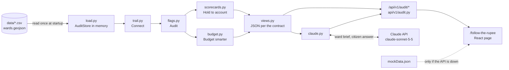

# Architecture

Follow the Rupee is one page and one set of API routes added to CivicLens. The page lives in a React frontend and the routes in a FastAPI backend. The audit reads CSV files, not the database, so it runs on a laptop with nothing else installed.



## Layout

```
data/                  hackathon CSVs, ward and road GeoJSON, DATA_DICTIONARY.md
docs/API_CONTRACT.md   the response shapes both halves build against
backend/
  app/audit/           the audit engine (pandas, no database)
  app/api/v1/audit.py  the /audit routes
  app/main.py          lifespan loads the AuditStore onto app.state
  tests/               unit tests per rule; tests/e2e runs the real app on the real data
frontend/
  src/pages/FollowTheRupee/   the page, its API client and the offline mock
  e2e/                        Playwright tests
```

The rest of `backend/` and `frontend/` is the CivicLens app (the map of representatives, complaints, budgets). It uses PostgreSQL with PostGIS. The audit doesn't touch it, and the backend starts even when the database is down.

## Backend

### Loading

`main.py` calls `load_store()` once when the server starts and keeps the result on `app.state.audit`. `load.py` reads every CSV from `DATA_DIR` (default `../data`), parses dates as IST and splits `linked_complaint_ids` on `|`. It joins work orders to roads (DLP status, resurfacing date), the rate card, contractors and ward budgets. It marks each job that finished within 7 days of a heavy-rain day or a big tide, because the scorecards compare like with like on that.

Cleaning complaints, building issues, computing each job's expected peer rates and raising every flag all happen at load time. Each request then works on DataFrames already in memory. Scorecards and plans are cut from them per request, which is quick at this size (2,499 jobs). The store also keeps a hash of the data folder, so a changed CSV gives fresh Claude cache keys.

### The four steps

Each step is one module, named after the four steps in the dataset README.

| Step | Module | Takes | Gives |
|---|---|---|---|
| Connect | `trail.py` | complaints, localities, ward polygons | each complaint with a ward and a clean category, grouped into issues, linked to work orders |
| Audit | `flags.py` | enriched work orders, issues | a list of flags, each with a work order id, reason, evidence and amount at risk |
| Hold to account | `scorecards.py` | work orders, flags | contractor and ward scorecards, observed against expected, with Wilson intervals |
| Budget smarter | `budget.py` | open issues, roads, hotspots, traffic, accidents, facilities | a ranked plan per ward, funded greedily within the remaining budget |

`views.py` turns these into the JSON shapes in `docs/API_CONTRACT.md` and returns `None` for unknown ids, which the routes turn into 404s. `report.py` prints the same numbers on the command line, for checking thresholds. The cutoffs and the reasoning behind each one are in `backend/app/audit/THRESHOLDS.md`.

### Claude

`claude.py` makes two calls, both to `claude-sonnet-5-5` and nothing else:

- `ward_summary` sends a ward's computed facts (money trail, scorecard, top flags, the top of the plan) and asks for a one-page corporator brief that cites work order ids.
- `ask` finds the complaint in the question (by id, or failing that by locality), sends its trail and asks for an answer in the asker's language. A keyword check picks the language before the call: English, Hindi, Marathi or Hinglish.

Claude only ever sees JSON the engine has already computed, so it can't add numbers of its own. The system prompt tells it to cite a work order for every claim, mention rain and low-lying context, and not accuse anyone.

If there's no `ANTHROPIC_API_KEY`, the API returns an error or the model refuses, both calls fall back to template text built from the same facts. Every response says whether it came from `claude` or `template`. Ward briefs are cached on disk in `backend/.audit_cache/`, keyed by data hash and ward. A template that stood in for a failed Claude call is never cached. Citizen answers aren't cached.

### Routes

All are under `/api/v1/audit`. The contract lists the shapes:

- `overview`, `wards`, `wards.geojson`, `wards/{code}` for the map and the ward panel;
- `contractors`, `contractors/{id}`, `flags`, `export/flags.csv` for the audit;
- `next-rupee/{code}` for the plan;
- `complaints/{id}`, `search`, `ask` for the citizen view;
- `wards/{code}/summary` for the brief.

Ward codes contain a slash, so the routes use FastAPI's `path` converter and take `F/S` raw.

## Frontend

The page sits at `/follow-the-rupee` and is wired into the existing path-based routing in `src/App.jsx`. It has three parts:

- A search box and an "ask in your language" box across the top.
- A ward map on the left, drawn as plain SVG from `wards.geojson` (24 polygons, no map key needed). It is shaded by failed-fix share or by amount at risk, and a keyboard-friendly ward list sits beside it.
- A ward panel on the right with four tabs: where the money went, what looks wrong, who delivered, and where the next rupee goes. The "Write a summary with Claude" button calls the brief.

`auditApi.js` is the only code that talks to the backend. If the API can't be reached, it switches to `mockApi.js`, which serves `mockData.json`, and the page shows that it's offline. `scripts/build-audit-mock.py` builds the mock from the CSVs with simplified rules, so its numbers are close to the real audit but don't match it. The mock loads lazily and costs nothing when the API is up.

Dialogs share the `useDialog` hook: Esc closes the top dialog only, and focus goes back to the control that opened it. Styles use the design tokens in `tailwind.config.js` and `followTheRupee.css`, with light and dark themes.

## Tests

| Where | What | Run |
|---|---|---|
| `backend/tests/test_audit_*.py` | one or more tests per flag rule on small fixtures, plus the Wilson interval, the expected rates and the allocator | `uv run pytest` |
| `backend/tests/e2e/` | the real app on the real CSVs, every `/audit` route, shapes per the contract, known rows firing, plan within budget, a Marathi ask | `uv run pytest` |
| `frontend/src/**/*.test.js` | choropleth buckets, formatting, search ranking | `npm test` |
| `frontend/e2e/` | the page in Chromium against a mocked API: tabs, keyboard, search to trail, Marathi ask, 390px. The `@live` test runs against a real backend on port 8000 | `npm run e2e` |

## Configuration

The backend reads `backend/.env.secrets`, which is ignored by git. Start from `backend/.env.example`, then run with `uv run --env-file .env.secrets uvicorn app.main:app --port 8000`. The audit needs none of it. With an empty file you get the template text instead of Claude.

The frontend needs no configuration for a local run. `frontend/.env.example` lists the optional overrides.
